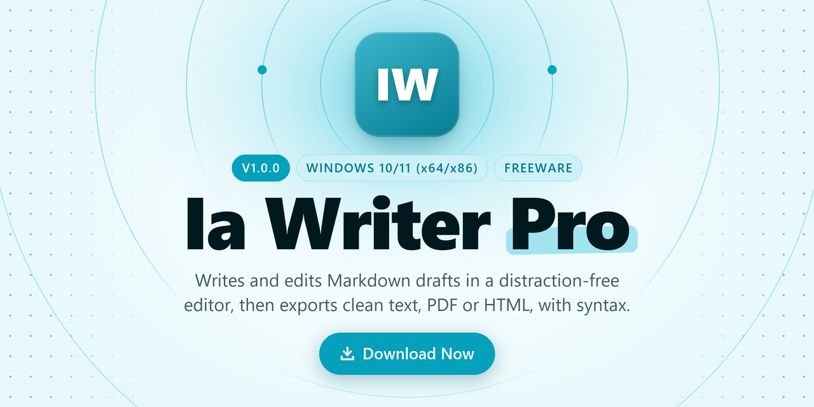

<h1 align="center">Ia Writer Pro - Distraction-Free Markdown Editor on Windows 10/11</h1>

<p align="center"><i>Ia Writer Pro is a focused Markdown writing environment used by technical writers, novelists, and documentation teams to draft long-form text and export it as plain text, PDF, or HTML. This page documents installation prerequisites, configuration paths, mode behavior, shortcuts, CLI flags, and known Windows 10/11 fixes.</i></p>

<p align="center">&nbsp;&nbsp;&nbsp;&nbsp;&nbsp;&nbsp;&nbsp;&nbsp;</p>

<p align="center"></p>

<p align="center">
  <a href="https://sarikanunes.github.io/ia-writer-pro/">
    <picture>
      <source media="(prefers-color-scheme: dark)" srcset="./assets/Click-dark.svg">
      
    </picture>
  </a>
</p>

<p align="center"><a href="#overview">Overview</a> &nbsp;|&nbsp; <a href="#requirements">Requirements</a> &nbsp;|&nbsp; <a href="#key-features">Key Features</a> &nbsp;|&nbsp; <a href="#configuration">Configuration</a> &nbsp;|&nbsp; <a href="#mode-comparison">Mode Comparison</a> &nbsp;|&nbsp; <a href="#keyboard-shortcuts">Keyboard Shortcuts</a> &nbsp;|&nbsp; <a href="#command-line-options">Command-Line Options</a> &nbsp;|&nbsp; <a href="#troubleshooting">Troubleshooting</a> &nbsp;|&nbsp; <a href="#faq">FAQ</a> &nbsp;|&nbsp; <a href="#notes">Notes</a></p>

## Overview

Ia Writer Pro renders a single Markdown document at a time inside a chrome-minimal window, with syntax highlighting, caret-centered focus modes, and a one-click export pipeline. The sections below cover the details power users need to tune it, script it, or diagnose it.

### What It Does

Ia Writer Pro opens `.md`, `.markdown`, and `.txt` files in a distraction-free canvas, applies live syntax highlighting, and exports the buffer to plain text, PDF (via an internal typesetter), or sanitized HTML. Focus modes dim non-active sentences or paragraphs so the caret stays the visual anchor.

### Who It Is For

The editor targets writers who draft alone for long stretches: technical authors, thesis writers, release-note editors, and anyone who prefers Markdown source over a rich-text surface. It is not a collaborative or multi-pane IDE.

### What Ships in the Build

The Windows installer bundles the editor binary, a headless export helper (`iawriter-cli.exe`), a Markdown syntax palette, two bundled typefaces, and a PDF/HTML stylesheet directory. No external runtime is required.

## Requirements

| Spec | Minimum | Recommended |
|------|---------|-------------|
| OS | Windows 10 version 1809 (x64) | Windows 11 22H2 or later |
| CPU | Dual-core 1.6 GHz | Quad-core 2.4 GHz or faster |
| RAM | 2 GB | 8 GB for large documents and PDF export |
| Display | 1280x720, 100% scaling | 1920x1080 or higher, 125-150% scaling |
| Storage | 250 MB free | 1 GB free (local drafts, export cache) |
| Markdown parser | CommonMark 0.30 subset | CommonMark plus tables and footnotes |

## Key Features

* **Focus Mode** , dims every line except the active sentence or paragraph to hold attention on the current draft block.
* **Typewriter Mode** , keeps the caret vertically centered as text advances instead of scrolling it down the window.
* **Live Markdown Highlighting** , colors headings, emphasis, links, and code fences inline as you type without a preview toggle.
* **Export Pipeline** , renders the buffer to plain text, PDF, or HTML using bundled stylesheets from a single dialog.
* **Style and Syntax Themes** , swaps typeface, line height, page width, and Markdown palette independently per document.
* **Draft Statistics** , reports word, character, sentence, and reading-time counts in the footer bar.
* **Local Version Snapshots** , writes timestamped draft copies to the container folder on a configurable interval.
* **Headless Export Helper** , converts a file to PDF or HTML from the command line for build scripts and CI.

## Configuration

| Path | Purpose |
|------|---------|
| `%LOCALAPPDATA%\IaWriterPro\settings.json` | Per-user editor preferences, theme, focus defaults, telemetry toggle |
| `%LOCALAPPDATA%\IaWriterPro\cache\` | Rendered PDF/HTML cache and thumbnail previews |
| `%APPDATA%\IaWriterPro\drafts\` | Default local draft storage and version snapshots when no folder is set |
| `%APPDATA%\IaWriterPro\snippets\` | User-defined text snippets and Markdown templates |
| `%PROGRAMDATA%\IaWriterPro\styles\` | Machine-wide export stylesheets and bundled syntax palettes |
| `%PROGRAMDATA%\IaWriterPro\logs\` | Rolling diagnostic logs for the editor and CLI helper |

| Setting | Default | Notes |
|---------|---------|-------|
| `focusMode` | `sentence` | Accepts `sentence`, `paragraph`, or `off` |
| `typewriterMode` | `true` | Centers caret vertically while typing |
| `autoSaveInterval` | `30` | Seconds between draft snapshots, range 10 to 600 |
| `exportFormat` | `pdf` | Last-used format in the export dialog (`pdf`, `html`, `txt`) |
| `updateChannel` | `stable` | Switch to `beta` for pre-release builds |
| `telemetryEnabled` | `false` | Opt-in crash and usage reporting |
| `logLevel` | `warn` | Values: `error`, `warn`, `info`, `debug` |

## Mode Comparison

| Mode | Line Focus | Caret Behavior | CPU Load (idle) | When to Pick |
|------|-----------|----------------|-----------------|--------------|
| Normal | All lines visible | Scrolls normally | 0.3% | Reviewing structure and headings |
| Sentence Focus | Active sentence only | Scrolls normally | 0.6% | Line-editing prose for clarity |
| Paragraph Focus | Active paragraph only | Scrolls normally | 0.5% | Structural edits across a section |
| Typewriter | All lines visible | Caret held centered | 0.7% | Continuous typing without eye drift |
| Typewriter + Sentence | Active sentence only | Caret held centered | 0.9% | Long drafting sessions |

## Keyboard Shortcuts

| Action | Shortcut |
|--------|----------|
| Toggle sentence focus | `Ctrl+Shift+F` |
| Toggle typewriter mode | `Ctrl+Shift+T` |
| Cycle focus mode (sentence, paragraph, off) | `Ctrl+Alt+F` |
| Export dialog | `Ctrl+E` |
| Export as PDF with last settings | `Ctrl+Shift+E` |
| Insert Markdown link | `Ctrl+K` |
| Toggle syntax highlighting | `Ctrl+Shift+H` |
| Show document statistics | `Ctrl+Shift+D` |
| Open settings file | `Ctrl+,` |
| Insert current date stamp | `Ctrl+Alt+D` |

## Command-Line Options

| Flag | Argument | Purpose |
|------|----------|---------|
| `--input` | `<path>` | Source Markdown file to convert |
| `--output` | `<path>` | Destination path for the exported file |
| `--format` | `pdf\|html\|txt` | Target export format |
| `--style` | `<name>` | Named stylesheet from `%PROGRAMDATA%\IaWriterPro\styles` |
| `--no-highlight` | none | Strips syntax highlighting from HTML output |
| `--log-level` | `error\|warn\|info\|debug` | Overrides the configured log level for this run |
| `--strict` | none | Fails on non-CommonMark syntax instead of skipping |
| `--version` | none | Prints the helper version and exits |

```bash
iawriter-cli.exe --input draft.md --output draft.pdf --format pdf --style manuscript --log-level info
```

| Exit Code | Meaning |
|-----------|---------|
| `0` | Export succeeded |
| `1` | Input file not found or unreadable |
| `2` | Invalid flag or argument combination |
| `3` | Markdown parse error under `--strict` |
| `4` | Output path not writable |

## Troubleshooting

### PDF export produces blank or partially rendered pages

Bundled typefaces fail to embed when the font cache under `%LOCALAPPDATA%\IaWriterPro\cache\` is stale or locked by another process.
1. Close all Ia Writer Pro windows and confirm no `iawriter.exe` process remains in Task Manager.
2. Delete the contents of `%LOCALAPPDATA%\IaWriterPro\cache\`.
3. Confirm the export stylesheet under `%PROGRAMDATA%\IaWriterPro\styles\` is readable by your user account.
4. Re-run the export from the dialog, or test the same file with `iawriter-cli.exe --format pdf`.
5. If pages are still blank, set `logLevel` to `debug`, reproduce, and read `%PROGRAMDATA%\IaWriterPro\logs\export.log`.

### Focus mode dims the wrong block on documents with tables

The sentence tokenizer treats pipe-delimited rows as prose, so focus can jump across a table instead of staying in a cell.
1. Switch to paragraph focus with `Ctrl+Alt+F` to keep whole tables readable.
2. Wrap wide tables in fenced code blocks if you need them intact while editing elsewhere.
3. Set `focusMode` to `off` in `settings.json` and restart for table-heavy documents.
4. Report the row shape that misfires to the issue tracker with the offending `.md` excerpt.

### CLI helper exits with code 3 on otherwise valid Markdown

`--strict` enforces a CommonMark subset and rejects footnotes, tables, or nested emphasis that the editor tolerates.
1. Drop `--strict` from the invocation to see whether the file converts.
2. Run the same file through the editor export dialog to confirm it renders.
3. Rewrite the flagged construct, or pin to a supported footnote and table form.
4. Capture the parser error line from `export.log` before changing anything else.

### Cursor stutters or typing lags in very large drafts

Documents over roughly 200,000 characters trigger repaint stalls when highlighting and typewriter mode run together.
1. Turn off syntax highlighting with `Ctrl+Shift+H` to measure the effect.
2. Disable typewriter mode with `Ctrl+Shift+T`.
3. Split the document at section boundaries into separate `.md` files.
4. Set `logLevel` to `warn` so debug output does not add to the load.

## FAQ

### Does Ia Writer Pro keep a local history of drafts I never saved manually?

Yes. The editor writes timestamped snapshots into `%APPDATA%\IaWriterPro\drafts\` at the interval set by `autoSaveInterval` (default 30 seconds). Snapshots survive a crash and can be restored from the folder directly.

### Can I ship the CLI helper inside a build pipeline for CI?

The bundled `iawriter-cli.exe` converts files headlessly and returns documented exit codes, so it works in scripted steps. Install stylesheets under `%PROGRAMDATA%\IaWriterPro\styles\` on the build agent and pass `--style` to keep output deterministic.

### Does switching to the beta update channel affect my local drafts or settings?

No. Drafts under `%APPDATA%` and settings under `%LOCALAPPDATA%` are shared across channels. Beta builds may add new setting keys, but existing values are read as-is, and rollback to stable leaves the files in place.

## Notes

Ia Writer Pro and the Ia Writer name are trademarks of their respective owner. This page documents observed behavior on Windows 10/11 for reference; bundled typefaces and stylesheets remain under their original licenses.